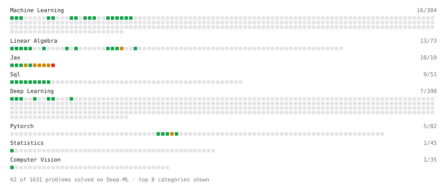

# Deep-ML

My machine learning practice from [Deep-ML](https://www.deep-ml.com). Every solution here was written by hand.

**Completed:** Jax (10/10)

**26** solved · 26 problems · 0 labs · 0 math

[**Browse the interactive portfolio**](https://aboussaado.github.io/deep-ml/) to replay this filling in over time.

## Problems

| | Difficulty | Solved | |
| --- | --- | --- | --- |
| [Average per group](https://www.deep-ml.com/problems/1108) | easy | 2026-10-17 | [solution](problems/1108-average-per-group) |
| [Batch Iterator for Dataset](https://www.deep-ml.com/problems/30) | easy | 2026-10-16 | [solution](problems/0030-batch-iterator-for-dataset) |
| [Calculate Covariance Matrix](https://www.deep-ml.com/problems/10) | easy | 2026-10-14 | [solution](problems/0010-calculate-covariance-matrix) |
| [Compiling Functions with jax.jit](https://www.deep-ml.com/problems/1327) | easy | 2026-10-15 | [solution](problems/1327-compiling-functions-with-jax-jit) |
| [Count rows per group](https://www.deep-ml.com/problems/1107) | easy | 2026-10-17 | [solution](problems/1107-count-rows-per-group) |
| [Feature Scaling Implementation](https://www.deep-ml.com/problems/16) | easy | 2026-10-15 | [solution](problems/0016-feature-scaling-implementation) |
| [Filter rows with WHERE](https://www.deep-ml.com/problems/1103) | easy | 2026-10-17 | [solution](problems/1103-filter-rows-with-where) |
| [Immutable Arrays: Functional Updates with .at](https://www.deep-ml.com/problems/1324) | easy | 2026-10-15 | [solution](problems/1324-immutable-arrays-functional-updates-with-at) |
| [One-Hot Encoding of Nominal Values](https://www.deep-ml.com/problems/34) | easy | 2026-10-16 | [solution](problems/0034-one-hot-encoding-of-nominal-values) |
| [Random Shuffle of Dataset](https://www.deep-ml.com/problems/29) | easy | 2026-10-16 | [solution](problems/0029-random-shuffle-of-dataset) |
| [ReLU with JAX Arrays](https://www.deep-ml.com/problems/1323) | easy | 2026-10-15 | [solution](problems/1323-relu-with-jax-arrays) |
| [Remove duplicates with DISTINCT](https://www.deep-ml.com/problems/1105) | easy | 2026-10-17 | [solution](problems/1105-remove-duplicates-with-distinct) |
| [SELECT all rows](https://www.deep-ml.com/problems/1101) | easy | 2026-10-17 | [solution](problems/1101-select-all-rows) |
| [Select specific columns](https://www.deep-ml.com/problems/1102) | easy | 2026-10-17 | [solution](problems/1102-select-specific-columns) |
| [Sigmoid Activation Function Understanding](https://www.deep-ml.com/problems/22) | easy | 2026-10-15 | [solution](problems/0022-sigmoid-activation-function-understanding) |
| [Single Neuron](https://www.deep-ml.com/problems/24) | easy | 2026-10-16 | [solution](problems/0024-single-neuron) |
| [Softmax Activation Function Implementation ](https://www.deep-ml.com/problems/23) | easy | 2026-10-15 | [solution](problems/0023-softmax-activation-function-implementation) |
| [Sort results with ORDER BY](https://www.deep-ml.com/problems/1104) | easy | 2026-10-17 | [solution](problems/1104-sort-results-with-order-by) |
| [Top N with LIMIT](https://www.deep-ml.com/problems/1106) | easy | 2026-10-17 | [solution](problems/1106-top-n-with-limit) |
| [Your First Gradient with jax.grad](https://www.deep-ml.com/problems/1325) | easy | 2026-10-15 | [solution](problems/1325-your-first-gradient-with-jax-grad) |
| [Fit a Line with value_and_grad](https://www.deep-ml.com/problems/1331) | medium | 2026-10-15 | [solution](problems/1331-fit-a-line-with-value-and-grad) |
| [Multi-Parameter Gradients with argnums](https://www.deep-ml.com/problems/1326) | medium | 2026-10-15 | [solution](problems/1326-multi-parameter-gradients-with-argnums) |
| [PyTrees: One SGD Step with tree_map](https://www.deep-ml.com/problems/1330) | medium | 2026-10-15 | [solution](problems/1330-pytrees-one-sgd-step-with-tree-map) |
| [Random Numbers the JAX Way: PRNG Keys](https://www.deep-ml.com/problems/1329) | medium | 2026-10-15 | [solution](problems/1329-random-numbers-the-jax-way-prng-keys) |
| [Vectorizing with jax.vmap](https://www.deep-ml.com/problems/1328) | medium | 2026-10-15 | [solution](problems/1328-vectorizing-with-jax-vmap) |
| [Per-Sample Gradients with vmap(grad)](https://www.deep-ml.com/problems/1332) | hard | 2026-10-16 | [solution](problems/1332-per-sample-gradients-with-vmap-grad) |

---

_This file is regenerated by Deep-ML on every push._
